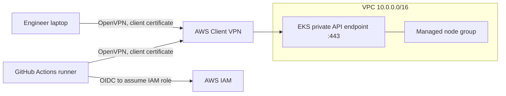
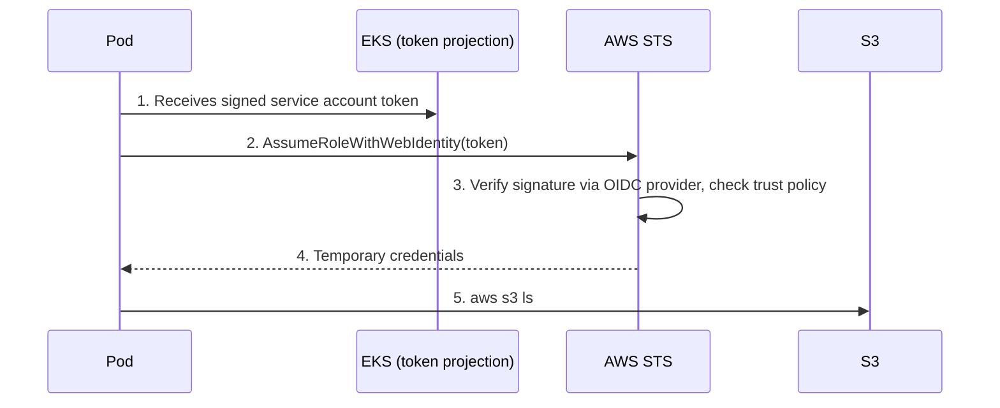

# EKS-Series

### Private Amazon EKS Platform on AWS: Terraform, GitOps-style CI/CD, VPN Access, RBAC and IRSA


-success)


A production-style reference platform that provisions a **fully private Amazon EKS cluster** with Terraform and manages its whole lifecycle (plan, apply, access setup, teardown) through **GitHub Actions**. Engineers and the pipeline reach the cluster only through an **AWS Client VPN**, humans get **least-privilege access with Kubernetes RBAC**, and workloads reach AWS services with **IAM Roles for Service Accounts (IRSA)** instead of access keys.

---

## Table of contents

1. [Highlights](#highlights)
2. [Architecture](#architecture)
3. [Repository structure](#repository-structure)
4. [Infrastructure components](#infrastructure-components)
5. [Security model](#security-model)
6. [IRSA: workload access to AWS](#irsa-workload-access-to-aws)
7. [CI/CD pipelines](#cicd-pipelines)
8. [Getting started](#getting-started)
9. [Day-to-day operations](#day-to-day-operations)
10. [Troubleshooting](#troubleshooting)
11. [Roadmap](#roadmap)
12. [Tools and versions](#tools-and-versions)

---

## Highlights

- **100% Infrastructure as Code.** VPC, EKS, IAM, certificates, VPN and IRSA are all defined in Terraform modules.
- **Private by default.** The EKS API endpoint is private only. There is no public path to the control plane.
- **No static credentials in CI.** GitHub Actions authenticates to AWS with **OIDC federation**, with no access keys stored in GitHub.
- **Certificate-based VPN.** AWS Client VPN with mutual TLS. The CA, server and client certificates are generated by Terraform and stored in ACM.
- **Least-privilege human access.** IAM role, EKS access entry, Kubernetes group and RBAC rules are chained so that a user gets only what the role binding allows.
- **IRSA for workloads.** Pods assume an IAM role through their service account, with no keys inside containers.
- **Guarded automation.** Pull requests run format, validate and plan. Applies and destroys sit behind a protected `Prod` environment, and destroy needs a typed confirmation.
- **Remote state.** Terraform state lives in S3 with locking.

---

## Architecture

### Network and access



### Human access chain

```
IAM user "Hassan"
   --sts:AssumeRole-->  IAM role "Hassan-eks-iam-role"
   --EKS access entry--> Kubernetes group "hassan-devops"
   --ClusterRoleBinding--> ClusterRole "hassan-devops-role" (what the group may do)
```

### IRSA flow



---

## Repository structure

```
EKS-Series/
├── .github/workflows/
│   ├── Infra-Automation.yaml        # Plan on PR, apply on main, VPN, RBAC, IRSA
│   └── Terraform-Destroy.yaml       # Guarded teardown with cleanup
├── Kubernetes-Manifest-File/
│   ├── rbac.yaml                    # ClusterRole + ClusterRoleBinding (hassan-devops)
│   ├── service-account.yaml         # ServiceAccount annotated with the IRSA role ARN
│   └── pod.yaml                     # aws-cli test pod that uses the service account
└── Terraform/
    ├── Calling-Modules/             # Root module (Terraform runs from here)
    │   ├── main.tf
    │   ├── Remote-Backend.tf        # S3 remote state
    │   ├── Terraform.tf             # Provider and version constraints
    │   ├── Variables.tf
    │   └── test.tfvars              # Environment values
    └── Modules/                     # Reusable module
        ├── VPC.tf                   # Network
        ├── EKS.tf                   # Cluster, node group, access entries
        ├── IAM.tf                   # Roles and users
        ├── ACM.tf                   # Certificates imported to ACM
        ├── ca_key&ca_crt.tf         # Private CA and client/server certificates
        ├── Client-VPN.tf            # Client VPN endpoint and security group
        ├── IRSA.tf                  # OIDC provider, S3 policy, IRSA role
        └── Variables.tf
```

---

## Infrastructure components

| Layer | Component | Details |
|-------|-----------|---------|
| Network | VPC | `10.0.0.0/16`, public and private subnets, internet gateway, NAT gateways, route tables |
| Compute | EKS cluster | `Dev-YT-Performance-Cluster`, `us-east-1`, private endpoint only, API authentication mode with access entries |
| Compute | Managed node group | `t3.medium`, ON_DEMAND, 1 to 10 nodes |
| Connectivity | AWS Client VPN | Certificate (mutual TLS) authentication, split tunnel, client range `10.100.0.0/22` |
| PKI | Certificates | CA, server and client certificates generated by Terraform and stored in ACM |
| Network security | Security groups | VPN security group allowed on TCP 443 of the cluster security group |
| Identity | IAM | Cluster role, node role, user `Hassan`, role `Hassan-eks-iam-role` |
| Authorization | Kubernetes RBAC | `ClusterRole` and `ClusterRoleBinding` for the group `hassan-devops` |
| Workload identity | IRSA | OIDC provider, IAM role `IRSA-S3-Role`, annotated service account |
| State | Terraform backend | S3 remote backend with state locking |

> `us-east-1e` is excluded from the zone list because the EKS control plane does not support it.

---

## Security model

| Control | Implementation |
|---------|----------------|
| CI authentication | GitHub OIDC federation to an IAM role (`AWS_ROLE_ARN`), with no long-lived keys in GitHub |
| Control plane exposure | Private endpoint only, reachable only through the VPN |
| VPN authentication | Mutual TLS with certificates generated per deployment |
| Human authorization | IAM role, EKS access entry, Kubernetes group, RBAC (explicit allow list) |
| Workload authorization | IRSA, with the trust policy bound to one namespace and one service account |
| Change control | Plan on every pull request, apply and destroy gated by the `Prod` environment |
| Destructive actions | Destroy workflow needs the typed confirmation `destroy` plus environment approval |
| Secrets in logs | Certificate material is written to temporary files and removed. Private keys are never echoed |

### What the `hassan-devops` group can do

| Resource | Allowed verbs |
|----------|---------------|
| Nodes, namespaces | get, list, watch |
| Pods, pod logs, services, configmaps | get, list, watch, create, update, patch, delete |
| Deployments, replicasets, statefulsets, daemonsets | get, list, watch, create, update, patch, delete |

Everything else is denied by default. Change `Kubernetes-Manifest-File/rbac.yaml` to adjust access.

---

## IRSA: workload access to AWS

IRSA lets a pod use an IAM role through its Kubernetes service account. EKS injects a signed token into the pod, and AWS STS exchanges it for temporary credentials.

| Resource | Where | Purpose |
|----------|-------|---------|
| OIDC identity provider | `Terraform/Modules/IRSA.tf` | Makes AWS IAM trust tokens signed by this cluster |
| `IRSA-S3-Permission-Policy` | `Terraform/Modules/IRSA.tf` | Defines the S3 permissions the role grants |
| `IRSA-S3-Role` | `Terraform/Modules/IRSA.tf` | Role with a trust policy bound to `system:serviceaccount:default:s3-access-sa` |
| `s3-access-sa` | `Kubernetes-Manifest-File/service-account.yaml` | Service account annotated with `eks.amazonaws.com/role-arn` |
| `aws-cli-pod` | `Kubernetes-Manifest-File/pod.yaml` | Test pod running as that service account |

**How the link works:** the annotation on the service account says which role to use, and the role's trust policy says which service account may use it. Both must match, or STS rejects the request.

**Verification:** after deployment, the pipeline waits for the pod and runs the check below. A successful bucket listing proves the whole chain works.

```bash
kubectl exec aws-cli-pod -- aws s3 ls
```

> `service-account.yaml` contains the role ARN, which includes the AWS account ID. Update it for your own account.

---

## CI/CD pipelines

### `Infra-Automation.yaml`

| Trigger | Job | Steps |
|---------|-----|-------|
| Pull request to `main` | **Plan** | Checkout, assume AWS role (OIDC), `terraform fmt -check`, `init`, `validate`, `plan` |
| Push to `main` (paths: `Terraform/**`, `Kubernetes-Manifest-File/*`, workflows) | **Apply** (environment `Prod`, requires approval) | Checkout, assume AWS role (OIDC), `init`, `plan`, `apply`, build VPN config from Terraform outputs, connect to VPN, apply RBAC, apply IRSA manifests and verify |
| Manual (`workflow_dispatch`) | Same as above | Same as above |

The VPN configuration is generated on every run. The pipeline exports the endpoint config from AWS and appends the current client certificate and key from Terraform outputs, so it always matches the deployed infrastructure and nothing needs refreshing after a rebuild.

### `Terraform-Destroy.yaml`

Manual only. The run needs the typed confirmation `destroy` and approval on the `Prod` environment.

1. Assume AWS role (OIDC) and `terraform init`.
2. **Cleanup** before destroying:
   - connect to the VPN,
   - delete the Kubernetes resources (service account, test pod, RBAC objects),
   - delete leftover IAM access keys of the `Hassan` user, which would otherwise block deleting the user.
3. `terraform destroy`.

### Required GitHub configuration

| Item | Value |
|------|-------|
| Repository secret `AWS_ROLE_ARN` | IAM role that the workflows assume through OIDC |
| Environment `Prod` | Add **required reviewers** so applies and destroys wait for approval |
| Workflow permissions | `id-token: write`, `contents: read` (already set in the workflows) |

---

## Getting started

### Prerequisites

- An AWS account and an S3 bucket for Terraform remote state (see `Remote-Backend.tf`).
- An IAM role trusted by GitHub OIDC for this repository, and its ARN saved as the `AWS_ROLE_ARN` secret.
- A GitHub environment named `Prod`.
- For local access: AWS CLI v2, `kubectl`, and the AWS VPN Client.

### Deploy

1. Review the values in `Terraform/Calling-Modules/test.tfvars`.
2. Update the account ID in `Kubernetes-Manifest-File/service-account.yaml`.
3. Open a pull request. The plan job runs.
4. Merge to `main` and approve the `Prod` environment. The apply job builds the infrastructure, connects to the VPN, and applies RBAC and IRSA.

### Connect from your computer

1. **Build your VPN profile.** In the AWS console, open **VPC, Client VPN endpoints**, and use **Download client configuration**. Then add the certificate and key from Terraform to the bottom of the file:

   ```bash
   cd Terraform/Calling-Modules
   terraform output -raw client_cert    # paste inside <cert> ... </cert>
   terraform output -raw client_key     # paste inside <key> ... </key>
   ```

   Import the file into the AWS VPN Client and connect.

2. **Configure the Hassan profiles:**

   ```bash
   aws configure --profile Hassan
   aws configure set role_arn arn:aws:iam::<ACCOUNT_ID>:role/<HASSAN_ROLE_NAME> --profile hassan-role
   aws configure set source_profile Hassan --profile hassan-role
   aws configure set region us-east-1 --profile hassan-role
   ```

   The role name starts with `Hassan-eks-iam-role-` and ends in a random number. Find it in the IAM console.

3. **Connect `kubectl` and check access:**

   ```bash
   aws eks update-kubeconfig --name Dev-YT-Performance-Cluster --region us-east-1 --profile hassan-role
   kubectl get nodes
   kubectl auth can-i create deployments    # yes
   kubectl auth can-i delete nodes          # no
   ```

---

## Day-to-day operations

| Task | How |
|------|-----|
| Change infrastructure | Pull request, review the plan, merge to `main`, approve `Prod` |
| Change cluster permissions | Edit `rbac.yaml` and merge. The apply job re-applies it |
| Change who can use the IRSA role | Edit the trust policy in `IRSA.tf` and the service account manifest together |
| Check IRSA | `kubectl exec aws-cli-pod -- aws s3 ls` |
| Tear everything down | Run **Terraform-Destroy**, type `destroy`, approve `Prod` |

> This platform costs money while it runs (EKS control plane, NAT gateways, nodes, VPN endpoint). Destroy it when you are not using it.

---

## Troubleshooting

| Symptom | Cause and fix |
|---------|---------------|
| `terraform fmt -check` fails in the pipeline | Run `terraform fmt -recursive` inside `Terraform/`, commit and push |
| `kubectl` times out on port 443 through the VPN | Check that the VPN endpoint uses `vpn-endpoint-sg`, that this group has an outbound rule (security groups made by Terraform have none by default), and that the cluster security group allows TCP 443 from it |
| `kubectl` cannot resolve the cluster name | The VPN endpoint needs `dns_servers` set to the VPC DNS (`10.0.0.2`) |
| `AccessDenied` on `eks:DescribeCluster` | Use the `hassan-role` profile, which switches into the role. The `Hassan` user cannot call EKS directly |
| `nodes is forbidden` | Check `rbac.yaml` and that the access entry has `kubernetes_groups = ["hassan-devops"]` |
| IRSA pod gets `AssumeRoleWithWebIdentity` denied | The namespace or service account name in the role trust policy does not match, or the role ARN annotation is wrong |
| Security group cannot be deleted for many minutes | EKS fixes a cluster's extra security group at creation. Changing it means the cluster is replaced |
| `InvalidPermission.Duplicate` on a security group rule | The same rule is defined twice, for example inline and as a separate resource. Keep only one |
| User `Hassan` cannot be deleted | An access key created by hand is still attached. The destroy workflow removes leftover keys |
| `kubectl apply` cannot find a manifest | The workflow path is relative to `Terraform/Calling-Modules`, so manifests are at `../../Kubernetes-Manifest-File/` |

---

## Roadmap

### DevSecOps (coming soon)

Security automation will be added to the pipelines so that every change is checked before it is applied:

- [ ] **Infrastructure-as-Code scanning** of Terraform on every pull request (for example Checkov or tfsec)
- [ ] **Secret scanning** to block committed credentials and keys (for example Gitleaks)
- [ ] **Container image scanning** for workloads that run on the cluster (for example Trivy)
- [ ] **Policy as code** for admission control in the cluster (for example OPA Gatekeeper or Kyverno)
- [ ] **Runtime threat detection** inside the cluster (for example Falco)
- [ ] **Dependency and provider checks**, with automated update pull requests

### Platform hardening

- [ ] Tighten the IRSA S3 policy to specific buckets and actions
- [ ] Run worker nodes in private subnets
- [ ] Separate dev, staging and prod environments with their own state
- [ ] Add logging, monitoring and alerting
- [ ] Add an ingress controller and a GitOps controller (for example Argo CD)

---

## Tools and versions

| Tool | Version or note |
|------|-----------------|
| Terraform | 1.16.6 |
| AWS provider | `~> 6.69.1` |
| CI/CD | GitHub Actions, AWS OIDC federation |
| VPN | AWS Client VPN, OpenVPN client on the runner |
| Kubernetes access | `kubectl`, EKS access entries, RBAC |
| Test image | `amazon/aws-cli` |